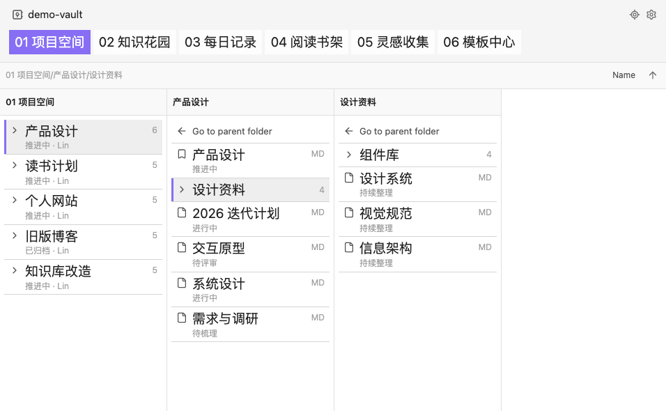
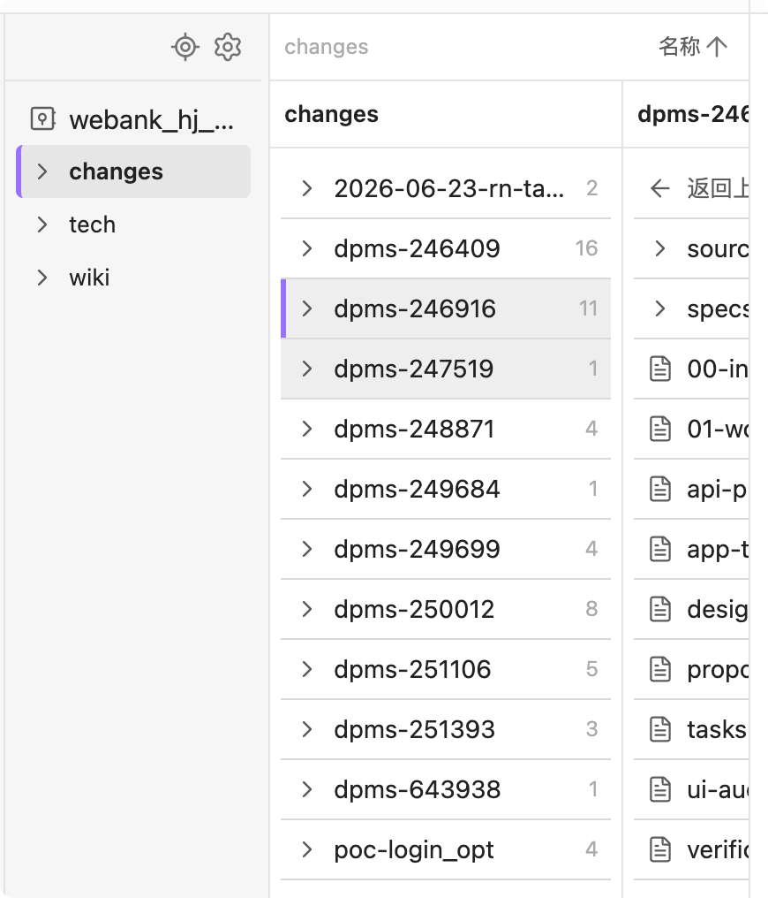
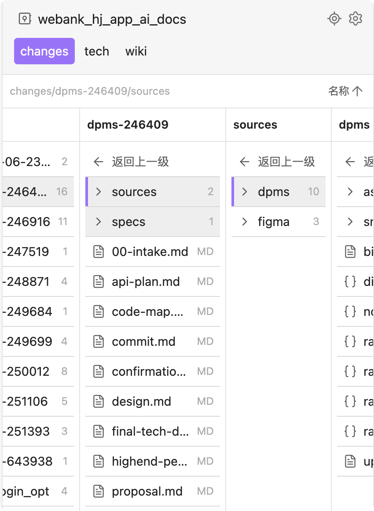
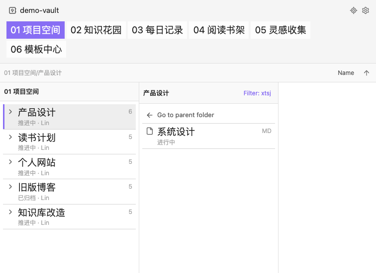
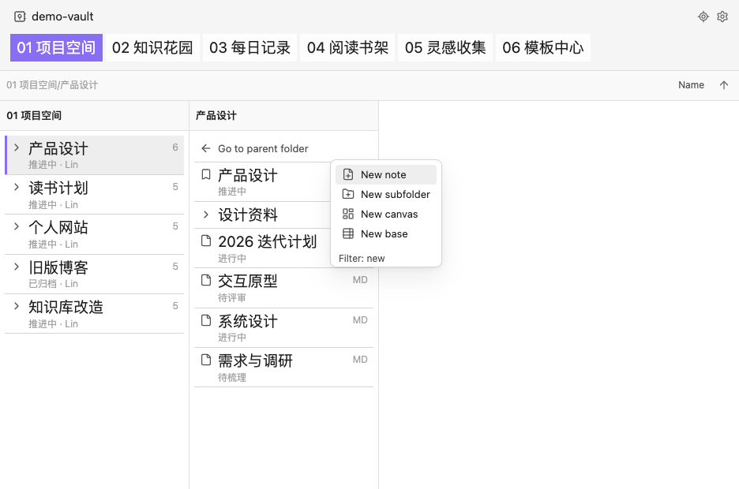

# Folder Column Navigator

[中文](#中文说明) · [English](#english)

Folder Column Navigator is a Finder-style, multi-column file navigator for Obsidian. It keeps top-level folders within reach and opens each folder level in its own column, so you can browse deeply while preserving context.

It is built for fast keyboard browsing: use `↑` `↓` `←` `→` to move, `Enter` to open folders or notes, and `Space` for the context menu. Type directly in the focused folder area or file column to filter—no search box required. Filtering supports English, numbers, Chinese characters, pinyin initials, full pinyin, and mixed pinyin; for example, both `nh` and `nih` can match “你好”. Opening a note keeps keyboard focus in the navigator, so you can continue browsing immediately.

> This plugin works entirely inside your vault. It does not send data over the network and does not collect telemetry.

## Compatibility

- Minimum Obsidian version: **1.13.0**.
- The plugin uses Obsidian's native categorized settings navigation and settings search APIs introduced in 1.13.0.
- Older Obsidian versions are not supported.

## Highlights

- Two layouts: a left-hand root-folder list or root folders displayed as top tags.
- Finder-style column browsing: opening a folder adds a column for its direct children.
- Optional vertical tree mode: after the configured maximum number of horizontal columns, deeper levels expand as a tree inside the last column (default maximum: 4 columns).
- Keyboard-first navigation across root folders, file columns, and filterable context menus.
- Per-column pinyin-aware filtering for English, numbers, Chinese characters, initials, full pinyin, and mixed pinyin queries.
- File-list-like sorting, item metadata, configurable icons, font sizes, widths, and hiding rules.
- A collapsible bottom calendar with month/year views and week numbers; click a day to open files matched by file dates, frontmatter dates, or filename date patterns.
- Built-in file and folder context menus, plus compatibility with other plugins through Obsidian's `file-menu` event.
- Same-folder multi-selection, batch moving/deletion/property editing, column-background drops, and persistent drag-defined ordering.
- Immediate duplicate-name validation when creating or renaming files and folders.

## Screenshots / 截图

### Top-level tags / 顶部一级目录标签

Use the top layout to dedicate the entire lower area to the file tree while keeping root folders one click away.



### Left navigation / 左侧一级目录列

Keep root folders ordered on the left, with the selected folder and its child columns visible together.



### Finder-style columns / Finder 风格多列浏览

Open each folder in its own column to retain the complete path and browse several levels in context.



### Pinyin filtering / 拼音筛选

Type English, numbers, Chinese text, pinyin initials, full pinyin, or mixed pinyin to filter the focused column.



### Context menu / 右键菜单

File and folder actions are available from the context menu, which also supports keyboard filtering.



### Bottom calendar / 底部日历

Expand the calendar at the bottom of the navigator to browse by month or year. Clicking a date opens its matching files directly, or presents a picker when there are multiple matches.

## Installation

### Community Plugins

Once the plugin is available in the Community Plugins directory:

1. Open **Settings → Community plugins**.
2. Search for **Folder Column Navigator**.
3. Install and enable it.

### Manual installation

1. Download `main.js`, `manifest.json`, and `styles.css` from a release.
2. Create `<vault>/.obsidian/plugins/folder-column-navigator/`.
3. Copy the three files into that folder.
4. Enable **Folder Column Navigator** in **Settings → Community plugins**.

Open the view from the ribbon folder icon, or run **Open Folder Column Navigator** from the command palette.

---

# 中文说明
## 兼容性

- 最低 Obsidian 版本：**1.13.0**。
- 插件使用 Obsidian 1.13.0 引入的原生分类设置导航和设置搜索 API。
- 低于 1.13.0 的版本不在支持范围内。

## 它解决什么问题

Obsidian 自带文件列表适合查看完整目录树，但在层级较深的仓库里，频繁展开、收起和横向寻找目录会打断阅读节奏。

目录文件列表将常用的一级目录集中到一个导航区域，并在右侧以 Finder 风格逐列展开目录。你可以一边保留上级目录上下文，一边继续深入文件夹；打开笔记后，焦点仍留在插件中，适合连续浏览和整理笔记。


## 键盘流与拼音快速过滤

这是一个键盘优先的目录浏览器：焦点位于一级目录或任一文件列时，无需打开搜索框，直接输入即可筛选当前区域。

- `↑` / `↓` 在当前区域移动，`←` / `→` 在父列、子列之间移动，`Enter` 进入目录或打开笔记。
- 支持英文、数字、汉字、拼音首字母、全拼和混合拼音；例如 `nh`、`nih` 都可以匹配“你好”。
- 筛选后，方向键只会在命中项中移动；`Backspace` 删除一个筛选字符，`Esc` 清除筛选。
- 打开笔记后焦点仍留在插件内，可继续移动并打开其他笔记；`Space` 可打开当前项目的右键菜单。


## 主要功能

### 两种一级目录布局

**左侧目录列**可在设置中选择：仓库根目录和一级目录位于左侧，右侧为当前目录的多列文件树。适合侧边栏较宽、需要长期浏览目录的场景。新安装默认使用顶部一级目录标签。

**顶部一级目录**可在设置中开启：一级目录以标签形式横跨视图顶部，下面全部空间都用于文件树。标签可自动换行、设置默认展示行数，并支持展开/收起超出的目录。

两种布局都支持：

- 拖拽调整一级目录顺序。
- 在设置中调整一级目录顺序或隐藏一级目录。
- 添加任意层级的自定义目录，并为它设置独立显示名称。
- 使用“定位当前笔记”跳转并展开当前编辑器笔记所在的目录链。

### Finder 风格多列文件树

- 单击文件夹，在右侧新增一列展示它的直属子项。
- 可选开启“深层目录纵向展开”：超过配置的最大水平列数后，后续层级会在最后一列以内按树形垂直展开，默认最多保留 4 列水平目录。
- 垂直目录树默认保留同级展开状态，也可以开启“展开时折叠兄弟目录”切换为单分支浏览。
- 单击文件，直接打开笔记；已打开的笔记会复用现有标签页。
- 每一列保留返回上一级入口，并能独立拖动调整宽度。
- 文件列宽度默认按内容计算；可在设置中设定最小和最大宽度。
- 在一级目录之间切换后，会记住该目录上次展开到的列和焦点位置。
- 移动文件或目录后，会自动定位并展开目标目录，保留键盘焦点以便继续操作。
- 文件或目录也可直接拖到目标目录；悬停约半秒会自动选中并展开该目录，再松开完成移动。
- 开启分组后，可将文件或目录拖到“归档”分组；松开后会为文件或文件夹笔记增加归档值。拖到其他分组则更新当前分组值。
- 文件或目录可拖到其他文件列的空白处，直接移动到该列对应目录。
- 同目录内可使用 `Shift` 连选、`Cmd`/ `Ctrl` 增减选择；多选项目可一起拖拽移动。

### 排序与显示

文件树右上角可按以下规则排序，并切换正序/倒序：

- 名称
- 修改日期
- 创建日期
- 自定义排序（拖动同级条目后自动切换，并按目录持久保存）

还可配置：

- 显示或隐藏目录子项数量、文件类型缩写等元信息。
- 一级目录与文件树的独立字号。
- 文件夹图标：文件夹、右箭头或不显示；横向多列浏览时图标保持不变，仅垂直树展开时切换打开文件夹或向下箭头。
- 文件图标：通用图标、按常见文件类型显示或不显示。
- 隐藏文件扩展名；不会影响右侧可单独关闭的类型缩写。
- 目录与文件名称左对齐。
- 文件夹笔记优先显示：当目录内存在与目录同名的文件时，将其识别为文件夹笔记，置顶并显示书签图标。
- 文件夹右键菜单可直接创建与文件夹同名的 Markdown 文件夹笔记；已有文件夹笔记时会提示，避免重复创建。

### 主题

插件内置三套视觉主题：简洁分格（默认）、彩色风格和手帐风格。可在插件的“设置 → 显示 → 主题”中立即切换，插件保存的主题选择会在启动时优先恢复，不会被旧的 Style Settings class 覆盖。彩色风格会按目录路径稳定分配识别色，并同步用于顶部标签、目录列、分组、右键菜单和日历；可从彩虹、海盐、森野、晚霞四套协调配色中选择。手帐风格使用纸张、贴纸和手帐卡片的视觉语言，覆盖文件树、操作按钮、右键菜单和日历。

### 底部日历与日期文件

日历首次可见且仓库加载完成后，分批建立内存日期索引，并显示更新提示；建索引和大批量排序会定期让出界面线程。多个日历视图共享索引，翻月/切周只查询对应日期，不重复匹配全库。文件创建、修改、属性变化、重命名和删除按受影响文件增量更新；修改匹配范围、隐藏规则或日期匹配规则才会分批重建，修改外观或每日笔记模板不会重建。索引不写入仓库，重载插件后会重新建立。

独立日历和匹配弹窗中的文件结果均为虚拟列表：只渲染可见区域附近的行，文件总数仍为全部匹配结果，滚动可访问所有文件，并支持上下方向键及 Home/End 定位。首次索引完成前暂停日期点击，避免将尚未匹配完成的日期误判为“无文件”而创建笔记；更新失败会显示重试提示，快速切换视图不会让旧查询覆盖当前结果。

#### 创建每日笔记

在“设置 → 日历 → 创建每日笔记”中配置创建规则，默认启用：

- 没有匹配文件的日期：点击后显示创建确认窗口。
- 已有匹配文件的日期：普通点击沿用打开行为，`Cmd + 点击`（Windows/Linux 为 `Ctrl + 点击`）创建新笔记。
- 独立日历下方的文件列表和匹配列表弹窗均提供“创建每日笔记”入口。
- 确认窗口展示最终路径、日期和类型；名称可以修改，实时检测同名，确认后自动创建缺失目录并打开笔记，绝不覆盖已有文件。

目录与名称支持两种共用规则的编辑方式：

- **积木组合**：目录组件库分为“基础”“日期相关”“固定文字”；基础目录和 `/` 归入“基础”。点击或拖入组件，通过拖拽或左右移动按钮排序；悬停组件可在右上角删除。目录分隔符显示为 `/`，与连接符、下划线、空格一样不可编辑；普通固定文字支持输入，但不能包含目录分隔符、模板括号或文件名非法字符，不提供文件/目录自动提示。基础目录单独支持仓库目录补全。日期组件可选择“选中日期”“周开始”“周结束”“今天（创建当天）”，格式只允许在同类日期单位内通过下拉切换；复杂格式在高级模板编辑。文件类型独立选择 Markdown、Canvas、Base，名称无需填写扩展名。
- **高级模板**：自由编辑固定文字和日期变量，例如 `日记/{{date:YYYY}}/{{date:MM}}/{{weekStart:YYYY-MM-DD}}-{{weekEnd:YYYY-MM-DD}}`，名称为 `{{date:YYYY-MM-DD}}`。支持 `date`（选中日期）、`weekStart`、`weekEnd`、`today`（创建当天）；周一为周开始日，与日历一致，周数使用 ISO 周数 `WW`。

提供按年月、平铺日期、按年月周三种预置方案，应用后可继续任意编辑。规则编辑器支持选择测试日期、实时预览完整路径，点击“保存创建规则”后生效；未保存的规则草稿不会改变创建行为，启用开关单独即时保存。

“创建每日笔记”位于日历设置底部。关闭启用开关会立即保存，并隐藏其余创建选项。常用方案按“按年月”（默认）、“平铺日期”、“按年月周”排列；备注说明应用后仍可编辑。“按年月周”的周区间使用 `MM-DD-MM-DD`（不含年）；“周开始”“周结束”组合积木也可直接添加。预览日期位于路径预览上方，目录组件库分为“基础”（基础目录和 `/`）、“日期相关”、“固定文字”三类。已有自定义规则不被新默认值覆盖，可用“应用方案”重新应用所选预置。

“基础目录”是独立的路径起点积木，只能出现在目录组合最左侧，不能重排或放入文件名；点击后可编辑仓库相对目录，并使用当前仓库目录补全。它与后续目录自动用 `/` 连接，清空或删除后从仓库根目录开始。基础目录不解析日期变量，高级模板模式也单独配置该前缀。旧规则中的完整固定前缀会自动转换为基础目录，生成路径不变。

日期组件还提供“周五”，默认显示月日，可作为日期来源选择；高级模板使用 `{{weekFriday:MM-DD}}` 或 `{{weekFriday:YYYY-MM-DD}}`。它取日历选中日所在自然周的周五（周一为周开始），不因节假日或调休改变；例如选中周日，仍取该周已经过去的周五，而不是下周五。

#### 中国大陆节假日与调休

日历设置中的“显示节假日”默认开启：放假日期与普通周末显示“休”，调休上班日期（包括周六、周日）优先显示“班”。普通周末不再附加“周末”文字，法定放假日期下方仍显示节日名称；窄列中名称省略，悬停可看完整说明。月视图、周视图以及底部与独立日历使用同一套标记。未收录年份的周末仅作周末标记，提示尚无调休数据，不作为已确认休息日。关闭显示不会改变工作日计算。周视图只展示一周七天，月视图固定六周；切换视图或调整宽度时重新校正尺寸。

内置 2025–2027 年离线数据，来源为 [holiday-cn](https://github.com/NateScarlet/holiday-cn) 对国务院放假公告的整理，采用 MIT 许可。数据适用于中国大陆统一放假安排，不代表个人排班、地方或企业额外假期，也不包含所有纪念日、农历节日和节气。

“允许联网更新”默认关闭。开启后填写年份，点击“更新该年数据”手动更新；不会在启动或翻月时自动联网。仅下载 `raw.githubusercontent.com/NateScarlet/holiday-cn/master/年份.json`，校验后缓存于当前仓库插件配置，后续可离线使用；网络失败、数据未发布、格式异常或保存失败均保留旧数据。跨年周建议同时更新相邻年份，以纳入下一年度公告中涉及的年末安排。设置中展示已收录年份与最近更新时间。

日期积木增加“本周最后一个工作日”，默认显示月日，也可在日期来源下拉中选择；高级模板为 `{{weekLastWorkday:YYYY-MM-DD}}`。按日历选中日所在的周一至周日计算，优先使用放假/调休安排，其余日期按周一至周五工作。例如 2026 年元旦所在周的最后工作日为调休上班的 1 月 4 日（周日），而不是周五。如果整周放假或跨入未收录年份，预览和创建弹窗会提示原因，不会悄悄退回周五或创建错误日期的笔记。

新建文件会关联日历所选日期，修改名称或选择 Canvas/Base 也能再次匹配到当天；该关联不受一般目录范围、类型及日期匹配开关限制，但仍遵循隐藏规则。文件重命名会同步关联，删除后清理。未指定正文模板时，Markdown 另外写入 `date` 属性。日期关联保存在当前仓库的插件配置中，不会自动同步到其他设备。

#### 日记正文模板

文件类型选择 Markdown 后，可在创建规则中设置“模板来源”和“模板文件”，默认不使用模板；输入模板路径时提供仓库 Markdown 文件提示，优先在所选模板系统配置的模板目录中查找。选择后点击“保存创建规则”生效，不会触发全库重新匹配。

- **Obsidian 模板**：兼容核心 [Templates](https://help.obsidian.md/plugins/templates) 的 `{{title}}`、`{{date}}`、`{{time}}` 及日期/时间格式变量。标题使用确认弹窗中的最终名称；本插件为日记将 `date` 设为日历选中日，`time` 使用实际创建时间。默认格式读取已启用核心模板的设置，否则使用 `YYYY-MM-DD` / `HH:mm`；不要求启用核心模板即可使用标准变量。不会执行 Templater 脚本。
- **Templater 模板**：必须安装并启用 [Templater](https://silentvoid13.github.io/Templater/)，使用其原生创建流程处理模板，而不是复制文本或再次执行覆盖命令。脚本、提示框、文件改名/移动等遵循 Templater 行为，最终按它返回的文件记录日历日期关联。`tp.date.now()` 等日期函数保持 Templater 原有语义，不会自动变成日历选中日；需要处理过去日期时，可从生成的文件标题解析日期。只应选择自己信任的模板，确认弹窗会显示脚本执行提示。集成核对了 2.26.0 的创建接口；缺少接口时明确提示，不会降级创建空白笔记。

指定正文模板时，模板内容原样作为基础，不额外插入 `date` 属性，以免破坏已有 frontmatter；日历日期关联仍会保存。不使用模板时继续生成默认 `date` 属性。Canvas、Base 暂不应用 Markdown 正文模板，但保留所选模板配置。缺少模板、插件未启用、读取或执行失败都会提示，不覆盖已有文件。

新安装默认不在文件列表底部展示日历，可在设置中开启，或通过命令打开独立日历视图。开启后底部“日历”栏可点击展开/收起。日历提供月视图与年视图、上一期/下一期导航和左侧周序号。默认通过文件属性和文件名匹配日期，创建/修改时间匹配默认关闭。

点击某一天后，插件会在仓库的可见文件中查找匹配项：

- 创建日期（`ctime`）和修改日期（`mtime`）。
- 文件属性中的日期；默认读取 `updated`、`created`、`创建日期`、`修改日期`、`date`。属性值支持 `YYYY-MM-DD`、`YYYY/MM/DD`、`YYYY.MM.DD`、`YYYY年M月D日`，也支持在更长文本中包含这些日期。
- 文件名日期格式；默认包含 `YYYYMMDD`、`YYYY年MM月DD日`、`YYYY-MM-DD*`。其中 `YYYY`、`MM`、`DD` 代表所点日期，`*` 代表任意字符；例如 `YYYY-MM-DD*` 匹配以该日期开头的文件名。

四类匹配规则和两组规则列表都可在设置的“日历”页独立调整。多个规则命中同一文件时只保留一项；仅命中一个文件会直接打开，命中多个文件则显示选择列表。

### 隐藏规则

在设置的“隐藏规则”中，每行填写一条相对于仓库根目录的 Glob 规则：

```text
附件/**
**/*.tmp
草稿/*.md
```

支持 `*`、`?` 和 `**`。命中目录后，其子项也会一并隐藏；这只影响插件视图，不会删除或移动任何仓库文件。

### 筛选细节

当前焦点位于一级目录或任一文件列时，直接输入即可筛选该区域：

- 支持英文、数字和汉字。
- 支持全拼、首字母与混合拼音，例如 `nh`、`nih` 可以匹配“你好”。
- 筛选期间，上下方向键只在命中的条目间移动。
- `Backspace` 删除一个筛选字符，`Esc` 清除筛选；筛选提示也可点击清除。

## 操作方式

### 鼠标

| 操作 | 效果 |
| --- | --- |
| 单击一级目录 | 切换当前目录并显示其内容 |
| 单击文件夹 | 在右侧展开子列 |
| 单击文件 | 打开文件 |
| 拖拽一级目录 | 调整一级目录顺序 |
| 拖拽文件/目录到目标目录 | 悬停后自动展开目标目录，松开后移动 |
| 拖拽文件/目录到其他列空白处 | 移动到该列对应目录 |
| 拖拽同级条目的上/下边缘 | 调整条目顺序并切换为自定义排序 |
| `Shift` + 单击 | 选择同目录内两个项目之间的连续范围 |
| `Cmd` / `Ctrl` + 单击 | 在同目录选择中增加或移除项目 |
| 拖拽列分割线 | 调整左侧目录列或文件列宽度 |
| 右键文件/文件夹 | 打开上下文菜单 |

### 键盘

| 按键 | 效果 |
| --- | --- |
| `↑` / `↓` | 在当前列或当前一级目录区域中移动焦点 |
| `←` / `→` | 在父列与子列之间移动；在文件夹上向右会展开子列 |
| `Enter` | 进入文件夹或打开文件 |
| `Space` | 打开当前文件或文件夹的上下文菜单；菜单打开后再次按 `Space` 关闭 |
| `Shift` + `↑` / `↓` | 向上或向下追加选择同目录的相邻项目 |
| `Esc` | 清除当前筛选；无筛选时关闭上下文菜单 |
| `Backspace` | 删除一个筛选字符；在上下文菜单中优先删除菜单筛选字符 |

在顶部布局中，`↑`、`↓`、`←`、`→` 会按标签实际所在的行和列移动。焦点位于最下面一排标签时，再按 `↓` 会进入文件树。

### 上下文菜单

文件菜单提供：打开、在新标签页打开、重命名、移动、删除等操作。

文件夹菜单提供：新建笔记、新建子文件夹、新建白板、新建数据库、移动、删除等操作。删除目录前必须在确认弹窗中再次确认。

同目录选中多个项目后，菜单提供批量移动、新建同级文件夹和确认删除；仅当所选项目全部为 Markdown 文件时，额外显示“批量设置属性”。列表属性会追加并去重，文本、数字、复选框、日期和日期时间会校验现有属性类型，修改完成后展示逐文件结果。

插件会兼容其他插件加入的标准文件菜单项；如需精简菜单，可在“高级”设置中关闭“显示扩展菜单项”，关闭后仍保留本插件自带操作。菜单打开后同样支持输入字母/数字筛选、方向键移动和 `Enter` 执行。

新建笔记、子文件夹、白板、数据库和重命名时，会在输入过程中实时检查目标目录是否已有同名文件或文件夹。出现冲突会立即提示并禁用确认按钮。

## 设置说明

设置页按 **导航**、**显示**、**高级**、**日历** 四个分类页面整理，并支持 Obsidian 设置搜索。

| 设置 | 作用 |
| --- | --- |
| 一级目录置顶展示 | 将一级目录切换为视图顶部的标签区域 |
| 顶部默认展示行数 | 限制顶部标签默认显示的行数，超出后可展开 |
| 显示条目元信息 | 显示文件夹子项数量和文件类型缩写 |
| 显示条目分割线 | 默认关闭；可显示文件、目录条目之间的横线，保留列边界和分组标题 |
| 一级目录名称字号 | 调整左侧模式下一级目录的字号 |
| 文件树文件名字号 | 同时调整文件树中的目录和文件字号；顶部模式下也控制一级目录标签 |
| 文件树名称左对齐 | 文件不显示图标时保留图标位置，使其与文件夹名对齐 |
| 文件夹笔记优先显示 | 将同名文件夹笔记置顶并使用书签图标 |
| 隐藏文件后缀名 | 只隐藏显示名称的后缀，不影响类型缩写设置 |
| 隐藏规则 | 按 Glob 规则隐藏文件和目录 |
| 文件列最小/最大宽度 | 限制拖拽文件列时的宽度范围 |
| 点击目录在当前列打开 | 默认开启，从第 3 列生效；点击目录用其内容替换当前列，并自动聚焦首个条目（不打开文件）；当前列内返回显示向上箭头，左方向键也可在当前列逐层返回并聚焦刚离开的目录；点击行为优先于纵向展开 |
| 打开目录后的横向定位 | 默认“当前操作列靠左”；也可选择保留左侧 1 列、保留左侧 2 列、新展开列靠左、新展开列靠右、不自动滚动。点击与 Enter 共用，左侧一级目录栏保持可见；上下方向键、当前列打开和纵向展开不触发。旧版显式关闭的配置迁移为“不自动滚动” |
| 文件夹图标 / 文件图标 | 分别控制文件夹、文件的图标样式；垂直展开时文件夹图标会显示打开/关闭状态 |
| 分组 | 按指定属性分组；支持逗号分隔值或 YAML 数组，普通多值只取第一个；只要任一值命中归档名称就归入底部“归档”分组，没有任何有效分组信息时不显示分组标题，缺少属性的条目归入“其他”；“其他”固定排在普通分组之后、归档之前 |
| 主题风格 | 在“显示 → 主题”中切换简洁分格、彩色风格和手帐风格；插件保存的选择在启动时优先恢复 |
| 彩色配色 | 彩色风格下切换彩虹、海盐、森野、晚霞四套协调配色，覆盖顶部标签、文件树、分组、右键菜单和日历 |
| 彩虹目录 | 默认开启；关闭后移除目录背景渐变和彩色装饰条，顶部标签和分组使用统一强调色，不影响主题与配色选择 |
| 右键菜单背景不透明度 | 调整插件右键菜单的背景不透明度，范围 40%–100%，默认 70% |
| 悬浮预览背景不透明度 | 调整文件和文件夹笔记预览窗口的背景不透明度，范围 40%–100%，默认 70% |
| 启用悬浮预览 | 开关文件和目录的悬浮预览 |
| 悬浮预览文件夹笔记 | 控制鼠标悬停目录时是否预览对应的文件夹笔记 |
| 悬浮预览延迟 | 配置鼠标悬停后显示预览的延迟，范围 350ms–2s，默认 500ms |
| 添加自定义目录 | 添加非一级目录到导航区域，并可设置显示名称 |
| 显示扩展菜单项 | 控制是否显示由 Obsidian 或其他插件通过 `file-menu` 添加的右键菜单项 |
| 日历 | 分别控制创建日期、修改日期、文件属性、文件名的日期匹配规则，并编辑属性名和文件名格式 |

## 隐私与数据

- 节假日联网更新默认关闭，仅用户开启后点击更新按钮才从 GitHub 下载公开年度数据，不上传笔记、文件名或路径；其他功能不主动访问网络。若选择 Templater 模板，用户模板脚本可能通过第三方插件执行网络请求或文件操作，请只使用可信模板。
- 不收集或上传任何笔记、文件名、使用行为或个人数据。
- 只通过 Obsidian API 读取并在需要时执行你主动触发的本地文件操作。
- 隐藏、排序、布局、宽度、导航、日记创建规则及日期与笔记路径的关联保存在当前仓库的插件数据中。

---

# English

## What it does

Folder Column Navigator adds a Finder-style multi-column navigator to Obsidian. Choose a top-level folder from a left-side list or from top tags, then browse each folder level in its own column while preserving context.

## Key features

- Keyboard-first navigation with `↑` `↓` `←` `→`, `Enter`, and `Space`; focus remains in the navigator after opening a note.
- Pinyin-aware quick filtering: type directly in the focused area to match English, numbers, Chinese, initials, full pinyin, or mixed pinyin.
- Left-side root-folder navigation or top-level folder tags.
- Finder-style multi-column folder browsing with resizable columns.
- Single-click file opening while keeping keyboard focus in the navigator.
- After moving a file or folder, automatically reveal and expand its destination folder while retaining keyboard focus.
- Drag files or folders onto a destination folder; hovering for about half a second reveals and expands it before drop.
- Name, modified-time, and created-time sorting in ascending or descending order.
- Optional property-based grouping; configurable archive values are shown as a collapsed “归档” group at the bottom.
- Dragging a file or folder onto “归档” adds the archive marker to its grouping property; dragging it onto another group updates the active group.
- Configurable item metadata, icons with open/closed folder states, font sizes, folder-note priority, extension visibility, and Glob-based hiding.
- Three built-in visual themes—Simple grid, Colorful, and Hand-account—are available in Settings → Display → Theme. The saved plugin selection takes precedence during startup. Colorful keeps a stable directory accent across navigation and columns, with four coordinated palettes: Rainbow, Ocean, Forest, and Sunset; Hand-account uses a paper-and-sticker journal treatment across lists, menus, controls, groups, and the calendar.
- Create a same-name Markdown folder note from any folder's context menu, with duplicate detection.
- Optional hover previews for files and folder notes, with a configurable delay.
- Filterable context menus for files and folders.
- Immediate duplicate-name validation when creating or renaming files and folders.

## Quick use

Open **Folder Column Navigator** from the ribbon or command palette. Click a folder to open its child column; click a file to open it. Use arrow keys to move, `Enter` to open, `Space` for the context menu, and type to filter the focused area. `Backspace` and `Esc` clear the active filter.

## Privacy

The plugin itself makes no network requests and collects no telemetry. Settings and daily-note date/path associations are stored in the current vault's plugin data. Optional Templater templates run through that third-party plugin and can execute user scripts, including network requests and file operations; use trusted templates only.

## Third-party software

The release bundle includes [pinyin-pro](https://www.npmjs.com/package/pinyin-pro) for pinyin-aware filtering. It is licensed under MIT. Build-time dependencies are documented in [THIRD_PARTY_NOTICES.md](THIRD_PARTY_NOTICES.md); they are not bundled with the plugin release.
